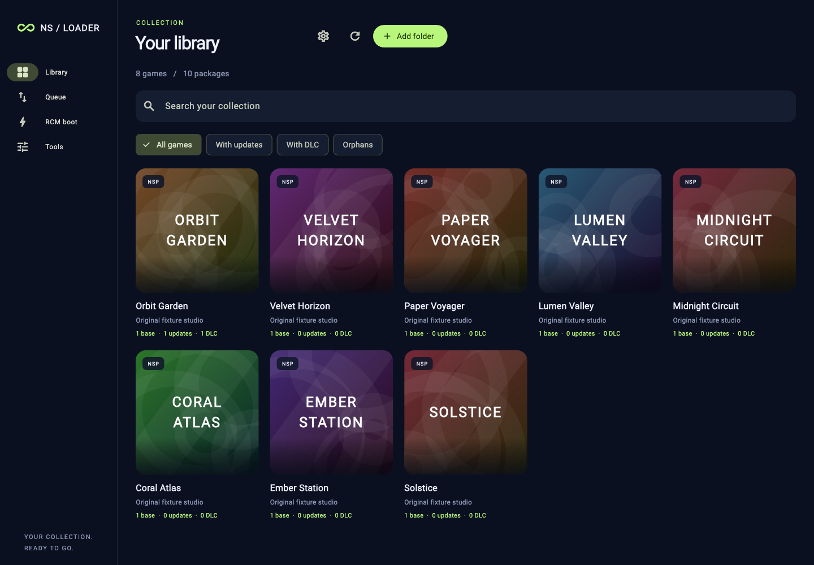
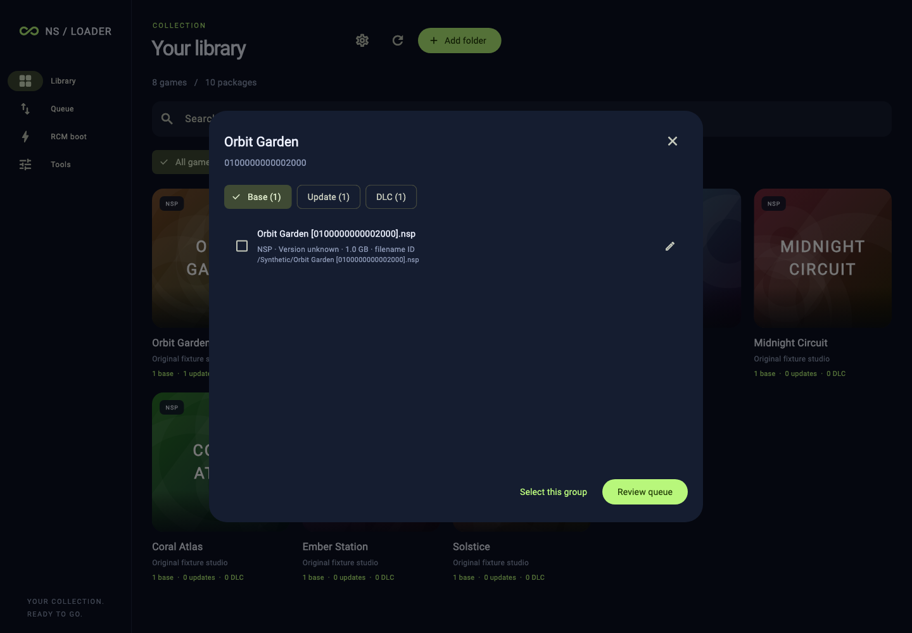

# NS-USBloader Flutter

An independent, Java-free desktop port of [NS-USBloader](https://github.com/developersu/ns-usbloader), targeting macOS, Windows and Linux. Dart owns the library, transfers, payload downloads and file tools. Flutter provides the desktop UI; libusb and a small C bridge provide USB access.



## What is implemented

- A cover-based library for NSP, XCI, NSZ and XCZ files, including validated numbered split directories. Folder scans skip symlinks, deduplicate paths and reuse unchanged metadata.
- One game card with separate Base, Updates and DLC groups. Copies, formats and versions remain individually selectable. Orphan content stays visible. No automatic grouping by name.
- Identity from bounded, plaintext PFS0/CNMT metadata when available, then explicit filename Title IDs, plus persistent manual overrides. Encrypted NCA metadata is not decrypted; filename IDs are visibly distinguished from package metadata. Ambiguous name matches remain suggestions.
- Optional [Title DB](https://github.com/blawar/titledb) metadata, language selection, English fallback, ETag refresh and external cover caching. Only display fields enter the persistent compact index.
- Awoo-compatible USB and network adapters. Network transfer supports full GET, HEAD, normal/open/suffix byte ranges, split packages and unique paths for duplicate filenames. Transfers serve only the selected manifest.
- Official Hekate and Atmosphère fusee release selection, bounded downloads, atomic cache publication and verification against published SHA-256 digests when available. Downloads never trigger injection. Cached payloads remain usable independently of release discovery.
- RCM payload framing and injection transport for vulnerable, unpatched hardware. USB operations run in a worker isolate. The selected device is rechecked before opening, and Linux/Windows trigger helpers contain no JNI.
- Cancellable split/merge with staging output, input preservation and existing-output refusal. A CLI shares the same domain APIs as the GUI.



Screenshots show only the application, invented titles and procedural artwork. No commercial game assets, keys, firmware or downloaded payload binaries ship in this repository.

## Run

Use an existing Flutter SDK; this checkout does not download its own SDK. The development environment uses Flutter 3.47.7 / Dart 3.13.5.

```sh
flutter pub get
flutter run -d macos     # or windows / linux on the corresponding host
```

macOS needs **full Xcode**, with its command-line tools selected, and CocoaPods if required by the installed Flutter toolchain. Command Line Tools alone cannot build the desktop runner. Install libusb separately (`brew install libusb`); Homebrew paths are discovered automatically. The desktop runner is intentionally unsandboxed so persistent user-selected folders and direct USB access work.

Linux needs Flutter's desktop compiler/GTK prerequisites and libusb (`libusb-1.0.so.0`). The native RCM helper is built and installed by the runner's CMake project. USB device permissions must allow the current user to access the selected device; the app does not run as root or change host permissions.

Windows needs Visual Studio's Desktop development with C++ workload. Place the matching architecture's `libusb-1.0.dll` beside the executable, or set `NSUSB_LIBUSB` to its absolute path. RCM additionally requires a compatible libusb-win32/libusbK driver; the oversized trigger is not supported by WinUSB. This implementation refuses Windows RCM when more than one matching device is present. It does not install or replace drivers.

`NSUSB_LIBUSB` overrides the libusb path on any platform. `NSUSB_RCM_BRIDGE` overrides the Linux/Windows helper path for CLI development:

```sh
cmake -S native -B build/native
cmake --build build/native
```

The standalone helper is Linux/Windows only; macOS uses libusb directly. For multi-configuration Windows builds, point `NSUSB_RCM_BRIDGE` at the DLL under `build/native/Debug` or `Release`.

## Use

1. Add a library folder. Open **Library settings → Refresh metadata** to enable names and covers in the chosen language. Each regional download is bounded to 160 MiB and may be large; future refreshes use ETags.
2. Open a game, choose Base / Update / DLC, and select individual packages. Use the edit action to identify or regroup uncertain content.
3. Open **Queue**. For network transfer, enter the console IP and this computer's reachable LAN IP. For USB, refresh devices and explicitly select the installer device. A compatible console-side installer must be running.
4. Use **RCM boot** to choose and cache an official payload or browse to a local one. Injection is a separate explicit action. Match fusee to the installed Atmosphère version; Nyx SD resources are separate from Hekate's injection payload.

Network progress measures the union of byte ranges written to the connection. It does **not** establish remote installation success. The HTTP session stays open for retries until cancelled. USB device exit and RCM trigger return codes likewise do not prove installation or boot.

Application preferences, metadata, artwork and payloads live under the operating system's application-support directory supplied by `path_provider`, outside the source tree. The CLI requires an explicit external payload cache directory.

```sh
dart run bin/nsusbloader.dart --help
dart run bin/nsusbloader.dart scan /path/to/library
dart run bin/nsusbloader.dart split example.nsp example-split.nsp
dart run bin/nsusbloader.dart merge example-split.nsp merged.nsp
dart run bin/nsusbloader.dart usb-list
```

## Validation and scope

```sh
flutter analyze
flutter test
# Optional public-network smoke check; never injects or installs:
dart run tool/live_smoke.dart
```

See [validation evidence](docs/VALIDATION.md) and [protocol boundaries](docs/PROTOCOLS.md). Synthetic protocol tests, desktop builds and physical device validation are separate gates. The CI workflow builds on each host; adding that workflow does not mean those remote builds have run.

This port does not implement Goldleaf virtual-drive RPC, legacy Goldleaf versions, the disabled upstream nxdumptool receiver, signature patching, or keys-based decryption. These are explicit parity boundaries, not hidden Java fallbacks. Format acceptance by a console-side installer is determined by that installer.

## License

GPL-3.0-or-later. Original NS-USBloader copyright and the [GPL license](LICENSE) are retained. See [upstream attribution and dependency notices](docs/UPSTREAM.md). No affiliation with upstream maintainers is implied. This project is independent of nsp-dawrin.
